

  
  <h1>Adaptive Resource Monitor</h1>
  
Live Windows and Linux system monitoring, a glance away in the Windows notification area.

<!-- arm-public-header:start -->
<!-- arm-public-version: v0.8.6.4_beta -->

<strong>v0.8.6.4_beta · Beta</strong> · Windows x64 · DC-ANCSA v1.0

<a href="https://phantom.zapto.org/gitea/sonja/Adaptive_Resource_Monitor/releases/tag/v0.8.6.4_beta">Latest release</a> · <a href="https://github.com/sonjamichelle/Adaptive_Resource_Monitor/releases">Download on GitHub</a> · <a href="LICENSE.md">Read the license</a>

  
  

<!-- arm-public-header:end -->

  
  
  
  

  <a href="#download">Download</a> · <a href="https://github.com/sonjamichelle/Adaptive_Resource_Monitor/wiki/Quick-Start">Quick Start</a> ·
  <a href="https://github.com/sonjamichelle/Adaptive_Resource_Monitor/wiki/User-Manual">User Manual</a> · <a href="https://github.com/sonjamichelle/Adaptive_Resource_Monitor/wiki">Wiki</a> ·
  <a href="https://github.com/sonjamichelle/Adaptive_Resource_Monitor/issues">Report Issue</a> ·
  <a href="https://github.com/sonjamichelle/Adaptive_Resource_Monitor/wiki/Development-Roadmap">Development Roadmap</a> · <a href="LICENSE.md">License</a>

Adaptive Resource Monitor (ARM) is a lightweight real-time monitor for Windows. Its live tray graph keeps recent activity visible while the app collects in the background. Hover for details, or open the expanded monitor to inspect measurements for the computers you choose. Each machine has its own resource history. Remote Linux hosts use an ordinary SSH connection and keep their credentials in Windows Credential Manager. You can choose the resources, colors, intervals, tray visualization and optional history recording. Application updates are cryptographically verified before installation.

[Report a Bug](https://github.com/sonjamichelle/Adaptive_Resource_Monitor/issues/new?template=01-bug-report.yml) · [Request a Feature](https://github.com/sonjamichelle/Adaptive_Resource_Monitor/issues/new?template=02-feature-request.yml) · [Get Support](SUPPORT.md) · [Browse Open Issues](https://github.com/sonjamichelle/Adaptive_Resource_Monitor/issues?q=is%3Aissue+is%3Aopen)

[GitHub repository](https://github.com/sonjamichelle/Adaptive_Resource_Monitor) · [GitHub releases](https://github.com/sonjamichelle/Adaptive_Resource_Monitor/releases) ·
[Development project](https://github.com/users/sonjamichelle/projects/1) ·
[Gitea development repository](https://phantom.zapto.org/gitea/sonja/Adaptive_Resource_Monitor) · [Repository synchronization](REPOSITORY_SYNC.md)

## Download

Use [GitHub releases](https://github.com/sonjamichelle/Adaptive_Resource_Monitor/releases) to download mirrored packages. The links below point to the authoritative signed Gitea release used by the current ARM updater.

<!-- arm-public-downloads:start -->
**v0.8.6.4_beta · Beta · Windows x64**

| Download | Size | Use it for |
| --- | ---: | --- |
| [Windows installer](https://phantom.zapto.org/gitea/sonja/Adaptive_Resource_Monitor/releases/download/v0.8.6.4_beta/AdaptiveResourceMonitor-v0.8.6.4_beta-windows-x64-setup.exe) | 57.3 MiB | A per-user installation with Start menu access, optional startup and managed upgrades |
| [Portable ZIP](https://phantom.zapto.org/gitea/sonja/Adaptive_Resource_Monitor/releases/download/v0.8.6.4_beta/AdaptiveResourceMonitor-v0.8.6.4_beta-windows-x64-portable.zip) | 71.1 MiB | Running ARM from an extracted folder with portable updates |

[Release notes and downloads](https://phantom.zapto.org/gitea/sonja/Adaptive_Resource_Monitor/releases/tag/v0.8.6.4_beta) · [All releases](https://phantom.zapto.org/gitea/sonja/Adaptive_Resource_Monitor/releases) ·
[SHA-256 checksums](https://phantom.zapto.org/gitea/sonja/Adaptive_Resource_Monitor/releases/download/v0.8.6.4_beta/SHA256SUMS.txt) ·
[Signed manifest](https://phantom.zapto.org/gitea/sonja/Adaptive_Resource_Monitor/releases/download/v0.8.6.4_beta/arm-update-windows-x64.json) ·
[Public verification key](https://phantom.zapto.org/gitea/sonja/Adaptive_Resource_Monitor/releases/download/v0.8.6.4_beta/arm-ed25519.pub)
<!-- arm-public-downloads:end -->

Use the **installer** for a per-user Windows installation with a Start menu shortcut and optional desktop shortcut or startup entry. Use the **portable ZIP** to run ARM from a folder you manage. Both editions use the same per-user settings and optional history directory. Both include the Python and Qt runtimes.

To compare a download with the published checksums, run the following in PowerShell from its download folder. Substitute the portable ZIP name to check that package.

~~~powershell
Get-FileHash -Algorithm SHA256 .\AdaptiveResourceMonitor-*-windows-x64-setup.exe
~~~

Compare the result with the same filename in **SHA-256 checksums**. The built-in updater also verifies the Ed25519-signed manifest and checks the downloaded package against that manifest. [Update verification details](UPDATE_MECHANISM.md)

## Quick Start

1. Download the Windows x64 installer. Run Setup, review and accept the software license, then launch **Adaptive Resource Monitor**.
2. Look for ARM’s live resource graph in the Windows notification area. If Windows puts it in the overflow menu, open **Settings → Personalization → Taskbar → Other system tray icons** and enable Adaptive Resource Monitor. You can also drag the icon out of the overflow menu. [Microsoft taskbar help](https://support.microsoft.com/en-us/windows/experience/personalization/customize-the-taskbar-in-windows)
3. Hover over the icon to see recent activity. Use **Details** to open the expanded monitor, or use **Pin/Unpin** to keep the hover monitor visible as you work.
4. Open **Settings** between **Resource Monitor** and **About**, or choose **Settings** from the tray menu. Both open the same settings page.

For a **portable** startup, extract the whole ZIP to a writable folder, then run <code>AdaptiveResourceMonitor.exe</code> from the extracted folder. Keep the files in that folder together.

<table>
  <tr>
    <td>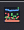</td>
    <td>The live notification-area icon represents the machine selected in <strong>Settings → Tray Icon</strong>.</td>
  </tr>
</table>

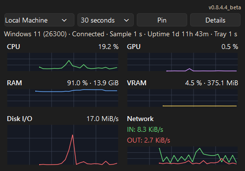

Windows installer and tray menu

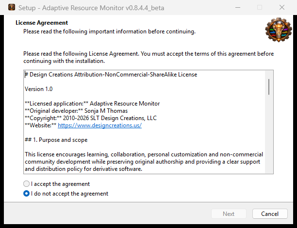

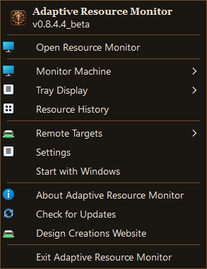

## Monitor a remote Linux machine

1. Open **Remote Targets → Manage Remote Targets** from the tray menu and select **Add**.
2. Enter a display name, a hostname or IP address, the SSH port and the Linux account name. The screenshot uses <code>linux.example.test</code> and <code>monitor</code> as examples.
3. Choose **Password** or **Private key**. For key authentication, select the key file and provide its passphrase if needed. ARM stores saved passwords and passphrases in Windows Credential Manager.
4. In **Manage Remote Targets**, select the new profile and use **Test connection**. Compare the SHA-256 host-key fingerprint with one you obtained from the Linux system or its administrator. Use **Approve SSH host key** once you have verified it, then retry the connection test.
5. Use **Connect** to enable and start monitoring the target. Check the target in the machine selector to display its graphs. You can leave it collecting in the background while looking at another machine.

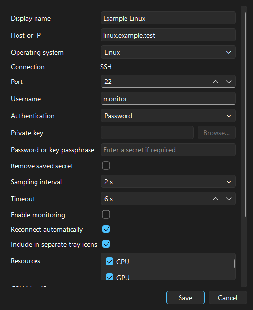

Remote Targets management

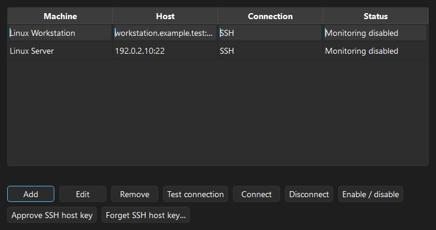

A reachable SSH service, a usable account, Bash, procfs and readable sysfs are needed. The desktop app sends a fixed read-only sampling program over SSH. An ordinary Linux target needs no ARM installation or root access. Some GPU metrics depend on driver interfaces and compatible vendor tools. [Remote setup and limitations](REMOTE_MONITORING.md) · [Telemetry providers](TELEMETRY_PROVIDERS.md)

## Features

### Resource graphs and machine views

ARM graphs CPU, GPU, RAM, dedicated VRAM, storage I/O and network traffic. Machine headers show Windows or Linux uptime. Open the expanded monitor for longer histories, detailed measurements and supported hardware breakdowns. A stale or unavailable reading is labeled in the interface.

Select one machine, a subset or **All Systems** with the checkbox dropdown. Each section represents one machine, and All Systems places their independent histories alongside one another. Hidden machines keep collecting. Drag a machine’s header or graph area to reorder its whole card. The saved order and selections apply to the hover monitor, expanded monitor and tray menu.

The examples below were captured from the Windows app with an isolated demonstration profile, live Windows and Linux readings, and generic labels. The unavailable example shows how ARM handles a disconnected target.

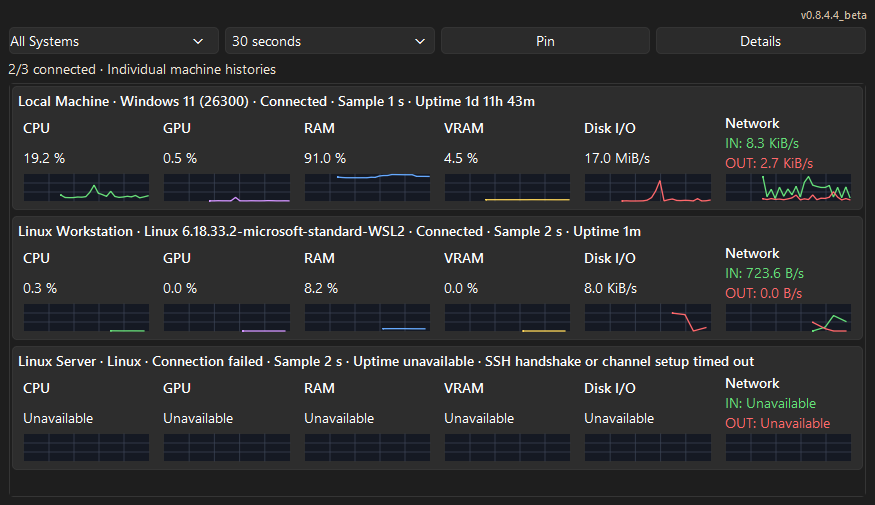

Checkbox selection, selected systems and sorting

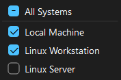

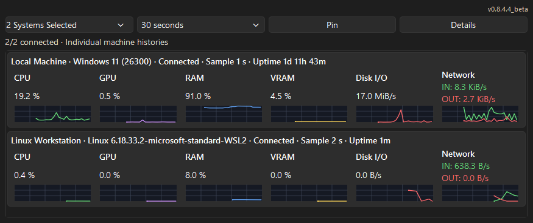

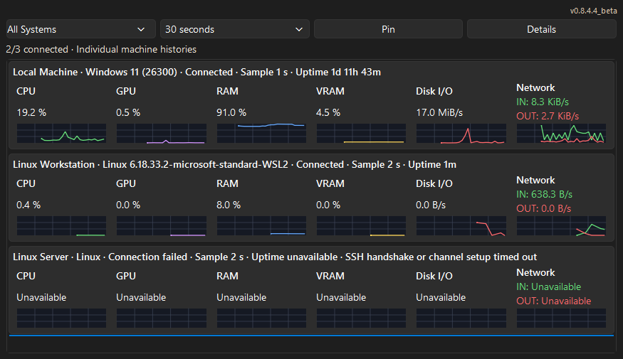

### Network activity and hardware details

Network **IN** is green and **OUT** is red by default. Both use a common throughput scale within each machine. Select a supported GPU, processor, disk or network interface for hardware details in the expanded view.

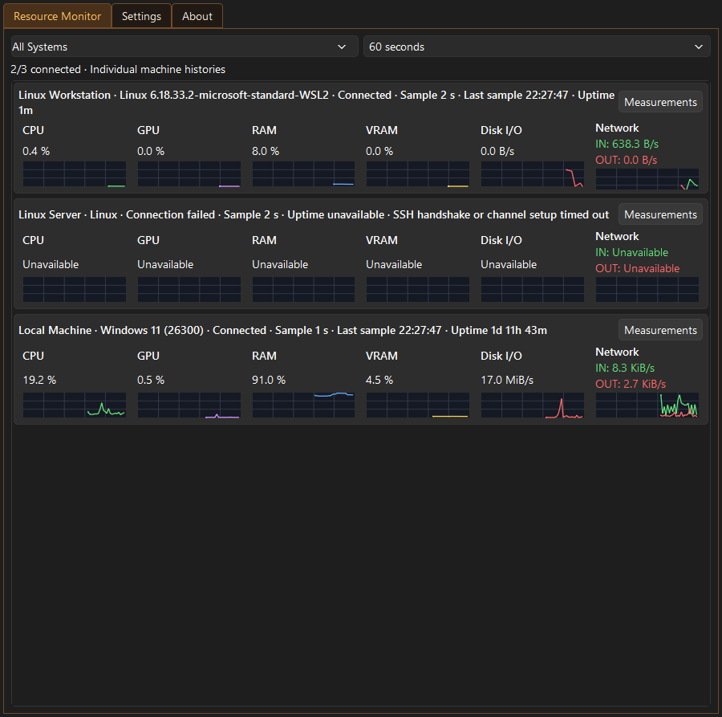

Measurements and hardware details

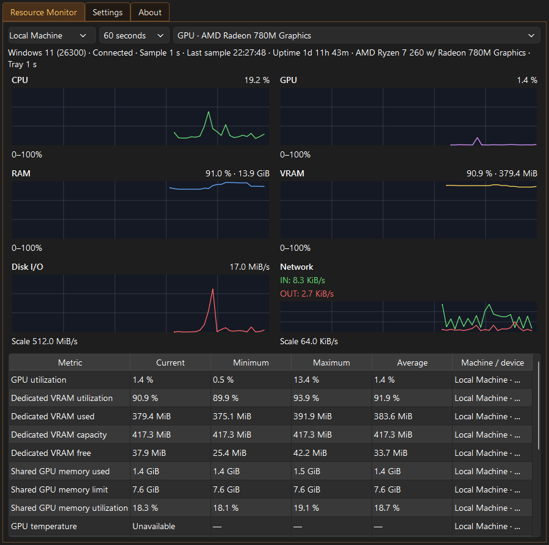

### Tray, settings and history

| Area | What you can change |
| --- | --- |
| Tray icon | Overlay, Stacked, Composite or branded Application Icon. Select its machine independently, or enable optional individual machine icons. |
| Hover monitor | History range, hover and dismissal delays, popup size, graph columns and visible graphs. Pinning uses the popup’s button. |
| Collection | Local and remote sampling intervals, selected devices and interfaces, and remote connection defaults. |
| Appearance | System, light or dark theme, graph colors and tray background. Window sizes and positions are saved where applicable. |
| History | Keep recent measurements in memory, or enable persistent recording with a retention limit, maximum size and chosen database location. |
| Startup and updates | Start with Windows, start minimized, update checks at startup or at a periodic interval, and Windows update notifications. |

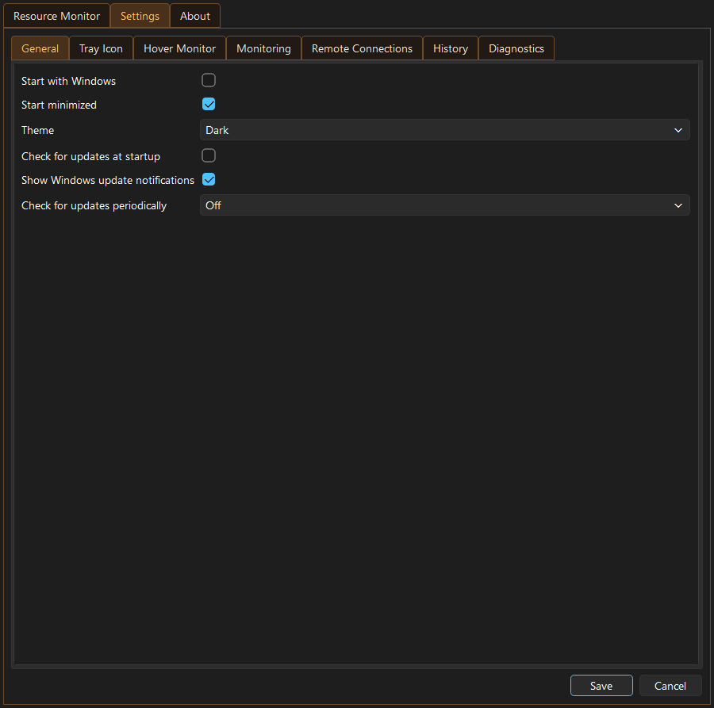

Tray visualization settings and the light theme

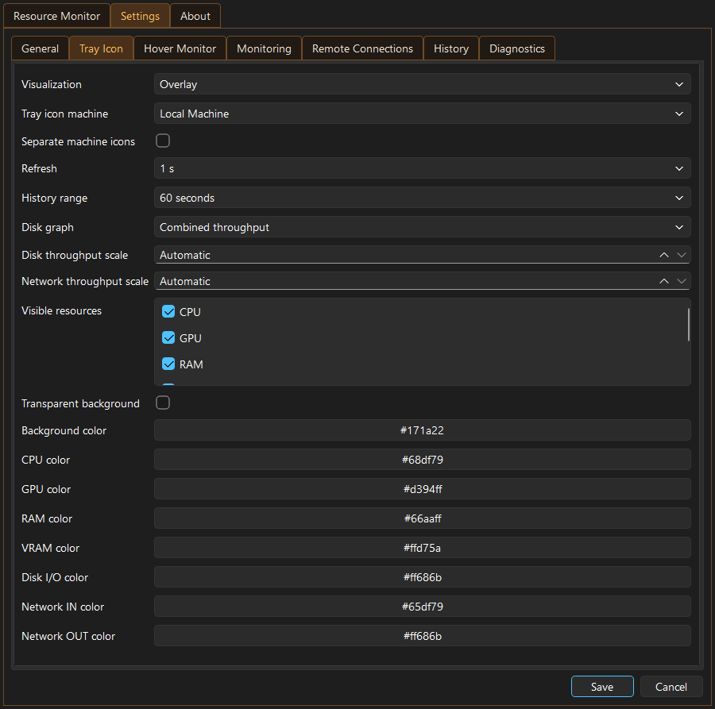

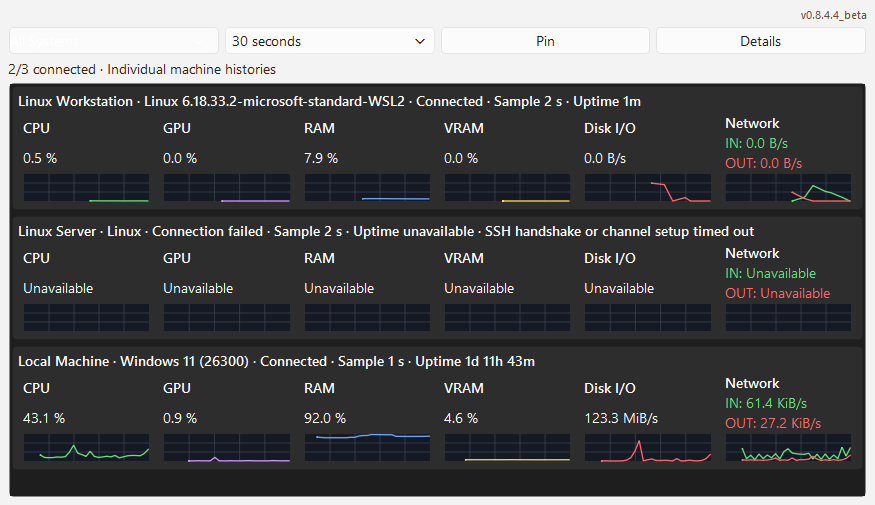

## Platforms and requirements

| Platform | Availability |
| --- | --- |
| Windows desktop x64 | Current native app. Verified on Windows 11 x64, build 26300. |
| Remote Linux systems | Available through SSH from the Windows desktop app. |
| Linux desktop | Planned native client. |
| Windows and Windows Server monitoring agent | Planned headless agent. |
| macOS desktop | Planned native client. |
| Android | Planned companion app. |
| iOS and iPadOS | Conditional feasibility targets. |

- **Windows build floor:** the installer specifies Windows build 17763 or later. Windows 11 x64 is the verified desktop configuration for this release.
- **Storage:** the v0.8.4.4_beta portable archive extracts to about 151 MiB. Leave additional space for extraction, future update downloads and any history database you enable.
- **Runtime:** the Windows packages contain CPython 3.12 and Qt/PySide6 6.11.2. End users can launch the bundled executable directly.
- **Hardware telemetry:** Windows GPU and VRAM readings depend on detected adapters, WDDM counters, drivers and NVIDIA NVML where available. Linux GPU readings depend on readable DRM/sysfs counters or NVIDIA tooling. Some machines report a useful subset of the counters.
- **Network:** local monitoring runs on the workstation. For Linux targets, allow connections to the configured SSH port. Update checks and downloads use HTTPS to the public release service.

### Performance

ARM updates the tray asynchronously and collects each machine’s samples independently. The table records short native Windows source-run observations from v0.8.2.3_beta on a Windows 11 x64 workstation with an AMD Ryzen 7 260, 16 logical processors, Radeon 780M graphics and a GeForce RTX 5050 Laptop GPU. Each row is a 12-second measurement.

| Mode | Machines and sample intervals | ARM CPU share of workstation | ARM working set |
| --- | --- | ---: | ---: |
| Overlay, tray only | One local, 1 s | 0.146% | 133 MiB |
| Composite, pinned hover | One local, 1 s | 0.155% | 147 MiB |
| Composite, background collection | One local at 1 s and two SSH loopback fixtures at 2 s | 0.138% | 154 MiB |

These observations describe that workstation and workload. Usage varies with devices, sampling rates, display mode and the number of connections.

## Application updates

Open **About → Check for Updates** for a manual check. ARM also offers startup and periodic checks under **Settings → General**. A verified update appears in the monitors and tray menu, and can issue a Windows notification when enabled. **Download Update** verifies and saves the package. **Install Later** keeps the verified package ready.

**Install Update** asks for authorization. Where the software terms require a new acceptance, review the complete terms before approving the update. The maintenance launcher waits for ARM to save its state and exit, verifies the package again, installs the update, and restarts ARM. Use **View Changelog** to open the release notes and dismiss the success banner. The completion receipt remains available. The maintenance launcher can recover or roll back a failed update where the previous application files can be restored safely. [Update and recovery details](UPDATE_MECHANISM.md)

Ed25519 authenticates the signed release information, including package filenames, versions, sizes and SHA-256 hashes. SHA-256 checks the downloaded bytes against that information. Windows Authenticode is a separate mechanism for verifying executable publishers. [Security and verification](SECURITY.md)

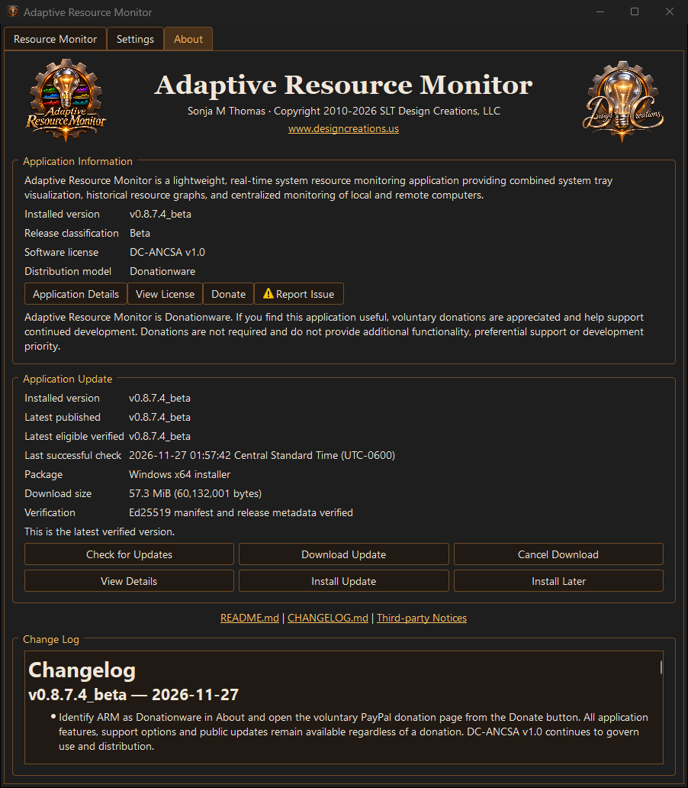

Update availability and installation progress

The availability panel below is the prior v0.8.2.3_beta updater discovering v0.8.4.4_beta. The maintenance capture shows the same verified upgrade in progress.

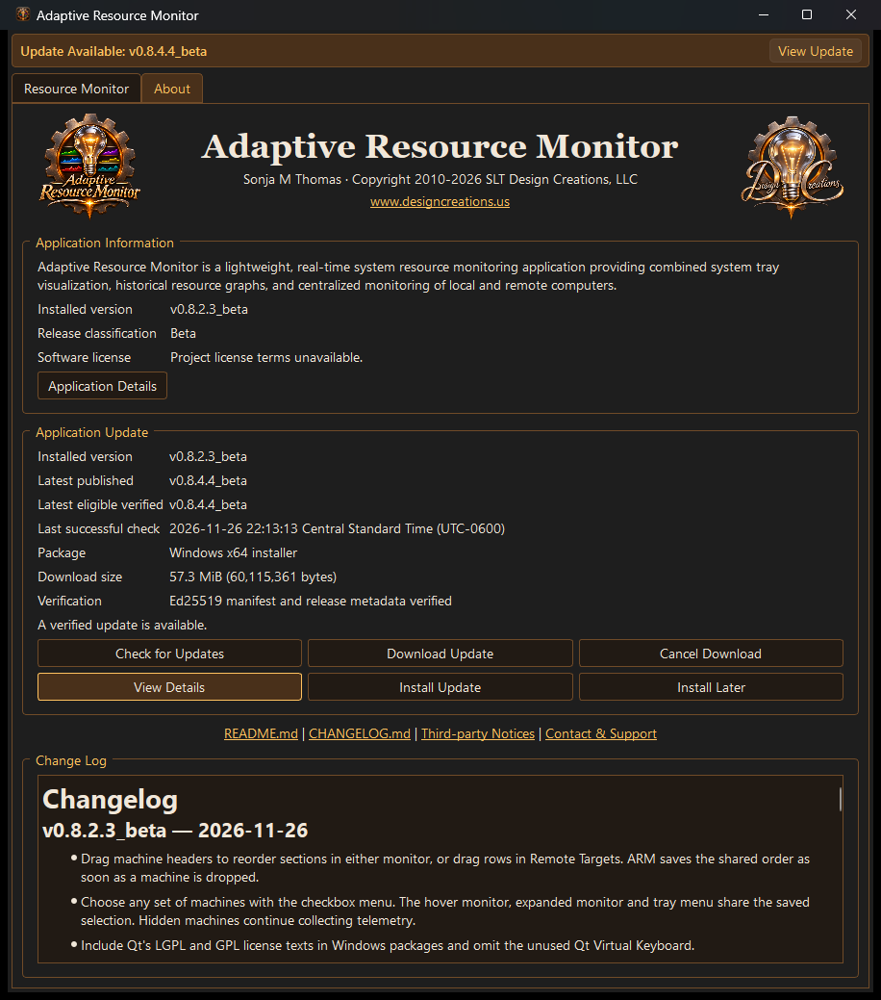

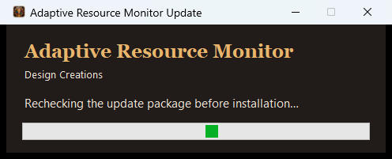

## Security and privacy

- **Remote telemetry.** ARM authenticates using the configured SSH account and verifies the host key. It sends a fixed read-only program and sampling requests over the encrypted SSH channel. The Linux host supplies hardware, resource, network counter and uptime readings. ARM uses those readings to render and, when enabled, record the histories on Windows.
- **Credentials and profiles.** Windows Credential Manager stores saved passwords and private-key passphrases. The local target profile stores its settings, a credential reference and, where applicable, the private-key path. Treat profiles, trust files and logs as private when sharing diagnostics.
- **Local storage.** Settings, pinned host keys and diagnostic logs are under <code>%LOCALAPPDATA%\Adaptive Resource Monitor</code>. Recording is optional and uses <code>history.sqlite</code> there by default. The portable edition uses the same per-user location.
- **Internet access.** Update activity sends HTTPS requests to the configured public Gitea release endpoints to check for releases or retrieve release metadata, changed license text and packages. Resource samples stay in the monitoring client and its configured local history store. ARM opens outbound SSH connections from the Windows desktop.

[Full security notes](SECURITY.md) · [Release integrity process](RELEASE_PROCESS.md)

## Troubleshooting

| Symptom | What to check |
| --- | --- |
| The tray icon is missing | Look in the notification-area overflow and enable ARM in taskbar settings. |
| SSH authentication fails | Confirm the host, port, account and selected authentication method. Check the password or key and use **Test connection**. |
| The SSH host key changed | Verify the new fingerprint with the system owner. Forget the old key and approve the replacement only after verifying it. |
| A remote disconnected | Check network reachability, SSH service availability and retry settings. A stale last reading can remain visible while the target reconnects. |
| GPU readings or a resource are unavailable | Check the driver or documented vendor interfaces, selected devices, enabled resources and connection status. |
| Update verification failed | Review About’s verification status and try the release check again. Use the signed public release and its published package checksums. |
| Setup or an upgrade failed | See the message in About and the maintenance and installer logs for the update transaction. The recovery instructions cover rollback and safe retry. |

Use **Settings → Diagnostics** for the active log path, logging level and collector states. The usual log is <code>%LOCALAPPDATA%\Adaptive Resource Monitor\arm.log</code>. Upgrade diagnostics are under <code>updates\transactions</code> in the same user data directory. Review a log and remove account, host and configuration details before sharing it. [Remote help](REMOTE_MONITORING.md) · [Recovery help](UPDATE_MECHANISM.md)

## Development roadmap

The [roadmap](ROADMAP.md) outlines a native Linux desktop app and a secure Windows and Windows Server agent. It also covers macOS and Android clients, conditional iOS and iPadOS support, an optional gateway, and lightweight service monitoring with uptime, availability and outage or recovery notifications.

## Software license

Adaptive Resource Monitor is **source-available** under the **Design Creations Attribution-NonCommercial-ShareAlike License v1.0 (DC-ANCSA v1.0)**. It permits non-commercial use, study and private modification. Unmodified releases may be redistributed for non-commercial use under the license with attribution, the applicable notices and access to corresponding source. Public distribution of derivatives and commercial use require prior written permission. Authorized derivatives are subject to the applicable share-alike and source requirements.

[Read the complete LICENSE.md](LICENSE.md) · [Register Derivative](https://www.designcreations.us/software/register-derivative.php?product=adaptive-resource-monitor) · [Third-party notices](packaging/THIRD_PARTY.md)

Offline license viewer in About

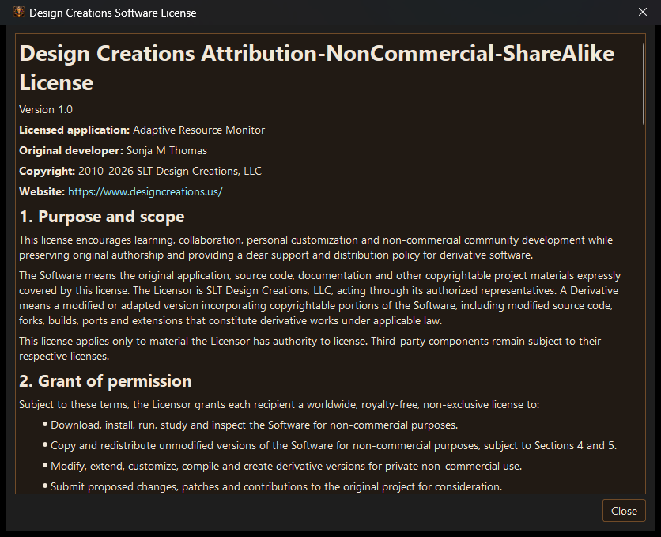

## Contributing and support

[Report a Bug](https://github.com/sonjamichelle/Adaptive_Resource_Monitor/issues/new?template=01-bug-report.yml) · [Request a Feature](https://github.com/sonjamichelle/Adaptive_Resource_Monitor/issues/new?template=02-feature-request.yml) ·
[Get Support](SUPPORT.md) · [View Development Roadmap](ROADMAP.md) ·
[Browse Open Issues](https://github.com/sonjamichelle/Adaptive_Resource_Monitor/issues?q=is%3Aissue+is%3Aopen) ·
[Register Derivative](https://www.designcreations.us/software/register-derivative.php?product=adaptive-resource-monitor)

Browse existing issues before creating a report. Use the matching form for hardware, remote monitoring, updates, performance or documentation. Submit proposed patches directly to the project for review. [Contribution guide](CONTRIBUTING.md) · [Issue and release workflow](ISSUE_MANAGEMENT.md)

Use the private reporting procedure for security issues. Independently distributed derivatives are supported by their own maintainers. [Private security reporting](SECURITY.md#report-a-security-issue) · [License terms](LICENSE.md)

## Development

ARM uses Python, PySide6/Qt, native Windows performance providers, hardware-specific GPU providers and Paramiko-based SSH. Jenkins builds and verifies Windows packages. Gitea distributes public releases.

On Windows x64, install Python 3.12 and run the following from a terminal. Inno Setup is needed only when building an installer. The application uses the current Windows user's ARM data directory when launched from source.

~~~powershell
git clone https://phantom.zapto.org/gitea/sonja/Adaptive_Resource_Monitor.git
cd Adaptive_Resource_Monitor
py -3.12 -m venv .venv
.\.venv\Scripts\python.exe -m pip install -r requirements.txt
.\.venv\Scripts\python.exe monitor.pyw
~~~

- [Build instructions](BUILD.md) · [Architecture](ARCHITECTURE.md) · [Telemetry providers](TELEMETRY_PROVIDERS.md)
- [Current development version](VERSION.md) · [Versioning](VERSIONING.md) · [Changelog](CHANGELOG.md) · [Roadmap](ROADMAP.md)
- [Remote monitoring](REMOTE_MONITORING.md) · [Security](SECURITY.md) · [Update mechanism](UPDATE_MECHANISM.md) · [Release process](RELEASE_PROCESS.md)

---

  
  
Original application developed by <strong>Sonja M Thomas</strong>, SLT Design Creations, LLC.

  
Copyright 2010-2026 SLT Design Creations, LLC · <a href="https://www.designcreations.us/">www.designcreations.us</a>

  
<a href="ARM_Application_Image.png">View the full Adaptive Resource Monitor artwork</a>

