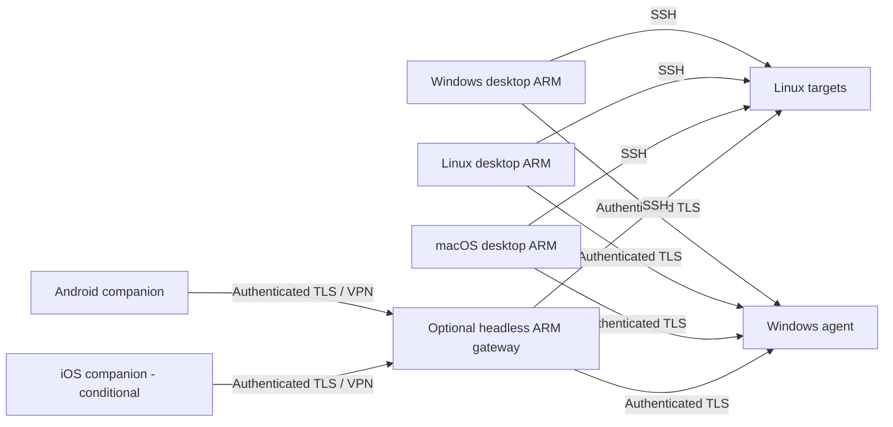

# Adaptive Resource Monitor (ARM)
## Cross-Platform Development Roadmap

**Roadmap revision:** 1.1  
**Date:** November 26, 2026  
**Original developer:** Sonja M Thomas  
**Copyright:** 2010-2026 SLT Design Creations, LLC  
**Website:** https://www.designcreations.us/  
**Repository:** https://phantom.zapto.org/gitea/sonja/Adaptive_Resource_Monitor  
**License direction:** DC-ANCSA v1.0; the authoritative repository LICENSE.md governs distributed releases.

## 1. Purpose and scope

Expand ARM from its accepted Windows-first Beta foundation into a family of native desktop monitoring applications and mobile companion clients. Preserve the lightweight, read-only nature of ARM while enabling Windows, Windows Server, Linux and macOS systems to be monitored from supported desktop and mobile hosts.

The primary next milestone is a native Linux desktop application with a small Windows monitoring agent service. Android is a planned companion platform. macOS is a planned native desktop platform. iOS and iPadOS are conditional feasibility targets, not commitments.

A lightweight, read-only service availability and uptime monitor is also planned for local and remote systems, independently of the desktop platform expansion.

This is a planning document, not authorization to implement, install, deploy, publish or change existing infrastructure. No release dates or future numeric versions are assigned until work is approved and scoped.

## 2. Existing foundation

The reported accepted Windows baseline is v0.6.2.2_beta, with a subsequently observed v0.6.2.3_beta installation. Drag-and-drop ordering, multi-selection and license integration have been requested separately; their final release status must be checked against VERSION.md and the release archive before development begins.

Preserve the existing six resource categories: CPU, GPU, RAM, VRAM, storage I/O and network. Network receive is green and transmit is red, with a shared scale. Preserve individual machine identity, independent histories, the single-machine tray source, optional individual tray icons, secure SSH profiles, signed updates, and Design Creations branding. Do not restore cross-machine aggregation.

Existing test infrastructure includes the Windows workstation, Rain and Phantom (Kubuntu), LAMP and PhantomNet (remote Linux targets), and the user's Windows Server 2022 environment. These are potential validation targets, not permission to modify them.

## 3. Target platform matrix

| Platform | Native monitoring client | Local telemetry | Remote Linux | Remote Windows / Server | Priority |
|---|---|---|---|---|---|
| Windows 11 / supported Windows 10 editions | Existing desktop | Existing | SSH | Agent | Maintain and extend |
| Linux desktop | Native Qt desktop | Planned | SSH | Agent | First expansion |
| Windows Server | Headless agent; GUI optional later | Agent | Not required | Agent target | First expansion |
| macOS | Native desktop / menu bar | Planned, capability-dependent | SSH | Agent | Planned |
| Android | Native mobile companion | Limited, optional | Via gateway; direct SSH optional later | Via gateway; direct agent optional later | Planned |
| iOS / iPadOS | Native mobile companion | Limited, optional | Via gateway | Via gateway | Conditional |

Windows Server 2022 is the initial server validation target; Server 2019 and 2025 are proposed compatibility targets, subject to native testing and supported OS/runtime combinations. Server Core must be tested separately from Desktop Experience. Linux x86-64 and macOS Apple silicon are initial targets; Linux ARM64, Intel macOS and Windows ARM64 are conditional on demand, available hardware and dependency support.

## 4. Architecture and shared foundation

Retain Python and PySide6 for desktop clients where practical. Extract platform-independent telemetry models, history, graph scaling, device selection, ordering, persistence, connection state and protocol logic into shared modules. Do not rewrite the accepted Windows client merely to port it.

Use separate platform adapters for OS counters, hardware vendors, credentials, notification areas, autostart, packaging and update installation. Mobile clients may use platform-native languages rather than embedding the desktop runtime. Maintain a versioned, documented wire protocol and shared conformance fixtures so clients and agents can evolve independently.

The gateway is optional for desktop use and recommended for mobile access. Direct desktop-to-target monitoring must continue to work without a gateway, cloud subscription or central server. No Internet-facing agent listener by default.

### Telemetry contract

Define stable machine and device identifiers, protocol version, agent version, capabilities, metric identifier, units, timestamps, sampling interval, validity and stale/error state. Support independent network RX/TX, physical disk throughput, device-level GPU and dedicated/shared memory distinctions. Report unsupported counters as unavailable, never as fabricated zeroes. Use monotonic time for counter deltas and UTC timestamps for transport; handle reboot, rollover, dropped samples and clock skew. Negotiate protocol versions and capabilities; tolerate additive fields and reject incompatible major versions clearly.

## 5. Phase 1: Native Linux desktop

### Scope

Deliver an actual Linux desktop application, not a Windows application under Wine, WSL or a browser wrapper. Start with Kubuntu/KDE Plasma on Rain and Phantom, then validate supported Ubuntu LTS and Debian-based environments. Expand to GNOME and other desktops after initial acceptance.

### Implementation

- Reuse the existing Qt interface, About and license presentation, six graphs, saved machine selection, drag-and-drop ordering and update notifications.
- Implement local telemetry using psutil and appropriate `/proc`, `/sys`, DRM, hwmon and vendor interfaces. Support NVIDIA NVML and capability-dependent AMD/Intel providers. Do not require root for ordinary monitoring.
- Keep existing SSH remote Linux collection available on Linux, including password authentication and optional keys. Use a desktop secret store such as Secret Service or KWallet; if unavailable, require explicit configuration or session-only credentials instead of plaintext fallback.
- Implement native tray/status notifier integration. KDE and GNOME differ in tray and hover support; validate X11 and Wayland separately. Where a desktop cannot support native hover, provide an accessible click-to-open popup and document the limitation rather than claiming parity.
- Use XDG configuration, cache, data and state locations; persistent per-user settings and crash-resistant saves. Provide desktop autostart and clean session shutdown.
- Offer a Debian package first; evaluate portable tarball or AppImage as a second distribution. Package-manager-owned installations must use the appropriate package upgrade mechanism rather than silently overwrite managed files.

### Acceptance

Native KDE operation on Rain and Phantom; actual local CPU/RAM/disk/network readings; vendor GPU/VRAM readings where supported; Windows agent connections once Phase 2 is complete; independent selected-machine histories; tray/popup behavior; reconnect, suspend/resume, restart and upgrade tests; settings and credential preservation; measured performance. Validate native Linux execution without modifying excluded storage devices or unrelated services.

## 6. Phase 2: ARM Windows Monitoring Agent

### Product scope

A small, headless Windows service installed on monitored Windows desktop and Windows Server systems. It exposes read-only telemetry to an authorized ARM client on Linux, Windows or macOS. The full desktop ARM application is not required on the monitored system. No logged-in user is required.

### Implementation direction

Evaluate a small native service using Go or Rust, or a self-contained .NET Worker Service if measured footprint and deployment requirements are acceptable. Select the implementation through a benchmark and dependency/licensing review. Keep the service independent of Qt and the desktop updater. A minimal optional configuration utility or CLI is sufficient.

- Register with Windows Service Control Manager, support automatic startup, graceful stop, bounded recovery and Event Log diagnostics.
- Use a dedicated least-privilege service identity; grant only necessary counter access. Avoid LocalSystem and administrator privileges at runtime unless a specific, documented counter requires an approved exception.
- Collect CPU, RAM, disk I/O and network through supported Windows APIs and performance counters. Use PDH and vendor GPU interfaces as appropriate; test session-zero GPU visibility and Windows Server driver modes. Report absent hardware and inaccessible counters accurately.
- Support Windows Server Core without desktop dependencies. No remote shell, arbitrary command execution, process termination, maintenance or system configuration API.
- Sample once per host at configurable intervals and serve multiple authorized viewers from bounded buffers. Provide backpressure, connection limits, timeouts, reconnect and rate limits.

### Secure enrollment and transport

Use a versioned HTTPS API or authenticated streaming protocol over TLS. Prefer mutual TLS with a per-agent identity and separately revocable client credentials. Define explicit enrollment: locally authorized pairing, verification of the agent certificate or trusted CA, short-lived enrollment secret, issuance of a scoped credential, and confirmation of machine identity. Never automatically trust an unknown or changed certificate.

Protect private keys using Windows certificate/key storage and restrictive ACLs. Store client credentials in the appropriate platform secret store. Support renewal, revocation, re-enrollment and auditable access. No shared default password, anonymous telemetry, plaintext tokens, disabled TLS verification or automatic port forwarding.

Bind only to configured interfaces; default to a safe non-public configuration. Create narrow, explicitly approved firewall rules for trusted LAN/VPN peers. Prefer VPN connectivity for off-site access. Document firewall and certificate requirements without assuming a public agent endpoint is needed.

### Service management and updates

Provide a Windows x64 service installer, clean uninstall, configuration export without secrets and signed update artifacts. Service installation and updates require explicit administrative authorization. Preserve enrollment identity across upgrades; support rollback and recoverable service startup. Do not let remote monitoring credentials authorize service updates. Do not expose an agent-update command to ordinary monitoring clients.

### Acceptance

Test Windows workstation and Windows Server 2022, including unattended operation after reboot and without interactive login. Verify other Server versions before claiming support. Demonstrate Linux-host-to-Windows monitoring of all supported metrics, multi-client access, invalid/revoked credential rejection, certificate rotation, firewall boundaries, connection loss/recovery, service upgrade/rollback and low resource use. Test no-GPU servers and GPU-equipped systems separately.

## 7. Phase 3: Native macOS desktop

Deliver an ARM application bundle with menu-bar status icon, compact popup and expanded independent-machine monitor. Reuse the Qt desktop core where supported; use native AppKit integration where Qt cannot provide reliable menu-bar behavior. Target Apple silicon first, evaluate Intel support separately.

Use supported macOS telemetry APIs (Mach/system statistics, network interface and disk counters, vendor/platform interfaces where available). Apple silicon unified memory must not be represented as a separate dedicated VRAM pool; label shared/unified memory explicitly or mark dedicated VRAM unavailable. Do not require root or private APIs for ordinary operation. Use Keychain for credentials and platform-supported login-item management.

Support SSH to Linux and authenticated Windows-agent connections. Provide a signed/notarized DMG or installer package as appropriate, with Gatekeeper validation, platform-specific update verification and safe rollback. A native Mac build agent, Apple signing identity and real Mac testing are prerequisites. Validate menu bar behavior, Retina scaling, multiple displays, sleep/wake, credentials, packaging and local/remote metrics before publication.

## 8. Phase 4: Optional headless ARM gateway

Provide a small independently deployable collector for continuous monitoring and mobile access. Linux/systemd is the initial deployment target. This is not required for native desktop use.

The gateway maintains explicitly configured SSH/agent connections, independent machine histories and optional retention, and exposes a read-only authenticated client API. Support multiple authorized users or device identities with per-machine access scopes, revocation, connection limits, audit logs, encrypted transport and bounded storage. Keep secrets local to the gateway; do not distribute SSH passwords to mobile devices. No cloud dependency, public exposure by default or remote administration functionality.

Support current snapshots and bounded history retrieval, reconnect/resume and timestamped stale data. Optional threshold alerts may be evaluated separately; mobile push infrastructure is not assumed. Provide native installation, service health reporting, backup/restore, signed upgrades and explicit retention controls. Validate on an approved Linux host without altering unrelated services or storage.

## 9. Phase 5: Android companion

Develop a native Android application, preferably Kotlin with Jetpack Compose, consuming the shared telemetry protocol through the gateway. Direct agent access or SSH may be evaluated later; the first release should not require storing server login passwords on a phone.

Provide selected-machine and all-machine views, independent six-category graphs, green RX/red TX, persistent sorting and checkbox selection, history range, connection status, last sample time, theme and About/license information. Adapt layouts to phones and tablets. Store device credentials in Android Keystore-backed storage; support revocation, network changes, VPN access and offline cached history with clear stale indicators.

Use foreground live streaming while the app is visible. Background work must comply with Android restrictions, notification requirements and battery policies; do not promise continuous polling while suspended. Prefer gateway-side collection. Evaluate optional notifications and widgets only after core acceptance.

Build signed APKs for authorized sideloading; evaluate AAB/Google Play distribution, signing and store policy compatibility separately. Do not implement a self-updater that bypasses Android package signing or store rules. Validate on real Android hardware (the Pixel 8 is a potential initial device), including Wi-Fi/mobile transitions, screen rotation, background/resume and battery/network overhead.

## 10. Phase 6: Possible iOS and iPadOS companion

This phase is conditional on developer resources, native Mac/Xcode access, real devices, distribution feasibility and user demand. Prefer Swift/SwiftUI with the shared gateway protocol.

Provide foreground remote dashboards, machine selection and ordering, history retrieval, stale indicators, Keychain-backed credentials and read-only authenticated access. Local phone hardware telemetry is optional and restricted to public supported APIs. Do not promise desktop-style system tray integration or unrestricted device-wide CPU/GPU/VRAM access.

Apple background execution is constrained and system-managed; continuous monitoring must occur on the gateway, not depend on the phone running indefinitely. Evaluate approved background refresh and optional push notifications only where useful and permitted. Do not misuse background modes to keep the app alive.

Evaluate TestFlight, App Store and other lawful distribution routes for compatibility with DC-ANCSA, third-party licenses and Apple's applicable terms. Require a native Mac build environment, provisioning and signing, device testing and privacy review before committing to release. No guarantee of store approval or release date.

## 11. Phase 7: Lightweight server and service monitoring

### Purpose and scope

Extend ARM beyond hardware resource telemetry to show whether selected server applications and services are running, reachable and healthy. Keep this an optional, simple monitoring feature, not a server administration suite. Support existing Windows and SSH-accessible Linux targets first, with the Windows agent, native Linux and macOS clients and mobile gateway consuming the same service status model as they become available.

### Initial service coverage

| Service or check | Monitoring approach |
|---|---|
| Apache HTTP Server | systemd or Windows service status; optional HTTP/HTTPS health probe |
| Nginx, Caddy, IIS | Native service status where available; HTTP/HTTPS probe |
| Jenkins and Gitea | Service status and configured application endpoint |
| SSH and Windows Remote Desktop | Service status and optional TCP reachability |
| MariaDB, MySQL, PostgreSQL | Service status and optional TCP or explicitly configured read-only health probe |
| PHP-FPM, Redis and other daemons | Configurable service unit or Windows service name |
| Emby, Sonarr, Radarr, Readarr, Prowlarr, Ollama | Optional service status and configured application endpoint |
| Custom applications | User-defined service name, HTTP/HTTPS endpoint or TCP host and port |

Examples are optional profiles, not hardcoded dependencies or permission to probe existing infrastructure. Do not automatically scan networks or discover services by probing arbitrary ports.

### Status and uptime

Display machine uptime separately from service uptime and observed endpoint availability. A service restart must not reset host uptime or another service's uptime.

- Machine uptime: elapsed time since the host booted, obtained from supported operating system counters.
- Service uptime: elapsed time since the current service activation or process start, when reliably exposed by the platform. Clearly distinguish service activation from individual worker process start times.
- Observed availability: successful checks since ARM began monitoring, with optional rolling 24-hour, 7-day and 30-day availability percentages and outage history. Do not present observation duration as actual service uptime.
- Show running, stopped, failed, starting, unreachable, unknown, unsupported and stale states as applicable. Distinguish a running service with a failing endpoint from a stopped service.
- Display last successful check, last status change, last known restart, current uptime and optional HTTP response code or probe latency. Report unknown values explicitly.
- Missing monitoring intervals must be recorded as unknown, not counted as confirmed uptime or downtime. Show coverage alongside any availability percentage.

### Collection and security

Use existing persistent SSH sessions for read-only Linux service queries (for example, allowlisted systemd properties and host uptime). Support Windows Service Control Manager status and supported process/counter information through the planned Windows agent; service start time may be unavailable or ambiguous for shared-process services. On macOS, evaluate supported launchd status interfaces when available.

HTTP/HTTPS and TCP checks may run from the desktop or optional gateway; label the probe origin because network reachability depends on where it is measured. Prefer safe read-only endpoints, bounded timeouts and verified TLS. Make expected HTTP status codes configurable so authentication-required endpoints are not automatically classified as outages. Do not treat TCP reachability alone as proof of application health. Do not require sudo, administrator credentials, arbitrary shell commands or remote configuration changes for ordinary service monitoring. Protect any optional probe credentials using the existing platform secret store and never include them in logs.

Allow independent service check intervals (default proposal: 30 seconds) and configurable timeouts. Run checks asynchronously, with bounded concurrency and backoff, so slow services cannot delay resource telemetry or other checks. Reuse existing connections where practical.

### User interface

- Add an optional Services view to the expanded Resource Monitor with independent, clearly labeled sections for each selected machine.
- Show service name, status, uptime, last check and optional latency, with compact status indicators and readable text.
- Allow a compact optional service summary beneath the relevant machine's resource graphs in the hover monitor; hide it when disabled. Do not add a seventh resource graph or change the primary live tray icon.
- Allow users to select which services to monitor, configure check methods and intervals, and reorder services. Persist selections and ordering immediately using stable identifiers.
- Keep service monitoring separate from machine visibility; hiding a machine's graphs must not stop its configured checks.
- Optional outage/recovery notifications may be enabled explicitly, with deduplication and configurable consecutive-failure thresholds. No automatic restarts, repairs or remediation.
- Mobile clients may display the same status and uptime information through the optional gateway, with clear stale indicators.

### Acceptance

Validate actual service uptime against native operating system evidence and verify configured Apache, Jenkins and Gitea health checks where authorized. Use disposable services or controlled fixtures for restart and failure tests; do not stop production services to demonstrate detection. Verify host reboot handling, service restart detection, endpoint failure while the service is running, authentication-required endpoints, TLS failures, disconnected machines, monitoring gaps, settings persistence and optional outage history. Measure added CPU, memory and network overhead. Preserve all accepted resource monitoring behavior and existing infrastructure.

## 12. Packaging, versioning and CI/CD

Retain the existing Jenkins controller at https://phantom.zapto.org:8080/jenkins/ and Gitea repository. Use existing native Windows and Linux build agents where suitable; add native macOS capacity and Android toolchains only when authorized. iOS builds require a suitable Mac/Xcode environment. Do not use WSL or virtual machines as substitutes for native production acceptance.

Maintain independent platform build stages and artifacts. Use the authoritative desktop version convention `vMAJOR.FEATURE.MINOR.BUGFIX_TAG` with cumulative independent counters. New platform components may require their own versions and maturity classifications; document compatibility with the shared protocol and decide the exact component version policy before first release. A Windows Beta does not automatically make Linux, macOS or mobile releases Beta.

Build automatically; publish only explicitly authorized, pinned Jenkins artifacts. Verify anonymous downloads, SHA-256 hashes, signed manifests, exact platform/architecture and package metadata. Preserve existing Windows updater compatibility. Use OS-native signing and distribution requirements in addition to ARM's Ed25519 manifests; manifest signatures are not Authenticode, Apple notarization or mobile package signing.

Preserve attribution and the authoritative LICENSE.md across all components. Audit third-party dependencies, runtime redistribution obligations, store terms and custom source-available license compatibility before publication. Keep signing secrets and enrollment credentials out of public source, artifacts and logs.

## 13. Cross-platform acceptance and performance

- Verify independent resource histories and machine identity; no cross-machine aggregation.
- Verify persistent selections, drag-and-drop ordering, window geometry and applicable platform preferences after restart, crash and upgrade.
- Verify valid zero, unsupported, stale and disconnected readings remain distinct.
- Verify least privilege, enrollment, certificate validation, revocation, secret storage and safe network defaults.
- Verify slow or failed targets cannot block other collectors or the UI.
- Verify real native installation, upgrade, shutdown, restart and recovery on each supported platform.
- Measure desktop and agent CPU, memory, disk and network overhead over extended runs; use the existing desktop target of less than 1% total CPU capacity under ordinary tray-only operation as a benchmark, not a guaranteed cross-platform result. Establish agent and gateway budgets from measured prototypes. Measure mobile battery and data consumption.
- Preserve production data and settings. Use disposable isolated instances for fault injection; do not install on real targets or publish without authorization.
- Record hardware, OS version, test duration, actual screenshots, protocol conformance, package signatures and unresolved limitations in the implementation report.

## 14. Milestones and dependencies

| Milestone | Deliverable | Release gate |
|---|---|---|
| M0 | Shared telemetry contract and platform abstraction | Windows regression suite remains green |
| M1 | Native Linux desktop preview | Real KDE/X11 and Wayland validation; documented limitations |
| M2 | Windows/Server agent and desktop integration | Secure enrollment and actual Linux-to-Windows Server monitoring |
| M3 | Linux production candidate and Windows client interoperability | Native install/update and sustained operation |
| M4 | Native macOS desktop preview | Real Mac hardware, signing and local/remote capability checks |
| M5 | Optional headless gateway | Authenticated API, retention, recovery and security acceptance |
| M6 | Android companion | Real-device tests and signed distribution |
| M7 | iOS/iPadOS feasibility and optional preview | Apple toolchain, policy, licensing and real-device feasibility |
| M8 | Lightweight service status and uptime monitoring | Read-only Linux/Windows checks, accurate uptime, independent endpoint health and measured overhead |

M1 and M2 may proceed in parallel after M0. M2 is required for full Linux-to-Windows acceptance. macOS can proceed independently once M0/M2 interfaces are stable. Mobile clients depend on the gateway/API contract, not on completion of macOS. iOS remains optional. M8 can begin independently on the existing Windows client using its SSH provider and extend to Windows agent targets after M2; it does not depend on mobile or macOS delivery.

## 15. Explicit non-goals

ARM remains a read-only resource and service availability monitor, not Adaptive Maintenance, a remote desktop system, an arbitrary remote shell, a process manager, a cloud surveillance service or a centralized administration suite. No cross-machine aggregate graphs, forced cloud accounts, mandatory agents on SSH-accessible Linux systems, automatic public exposure, or unapproved deployment. Do not create artificial release versions solely to demonstrate progress.

## 16. Reference documentation

These are implementation reference starting points; verify current platform support and policy at the time of implementation.

- Microsoft Windows services: https://learn.microsoft.com/en-us/windows/win32/services/services
- Windows performance counters: https://learn.microsoft.com/en-us/windows/win32/perfctrs/performance-counters-portal
- Qt system tray: https://doc.qt.io/qt-6/qsystemtrayicon.html
- XDG Base Directory Specification: https://specifications.freedesktop.org/basedir-spec/latest/
- Apple background execution: https://developer.apple.com/documentation/uikit/about-the-background-execution-sequence
- Apple background tasks: https://developer.apple.com/documentation/uikit/using-background-tasks-to-update-your-app
- Android background work: https://developer.android.com/develop/background-work
- Android Keystore: https://developer.android.com/privacy-and-security/keystore

---

**Roadmap status:** Proposed future development. Existing Windows Beta maintenance continues independently. Implementation order, exact release versions, supported OS matrices and platform-specific distribution decisions remain subject to approval and native validation.
